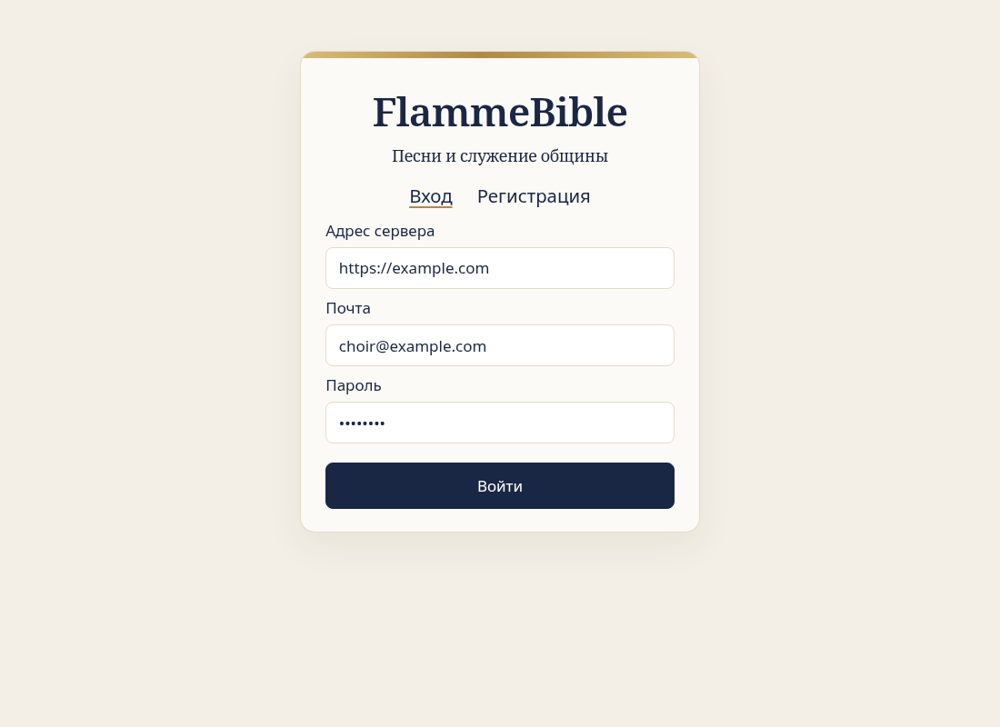
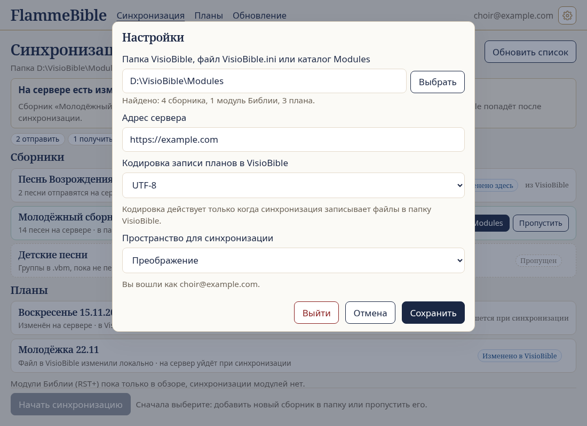
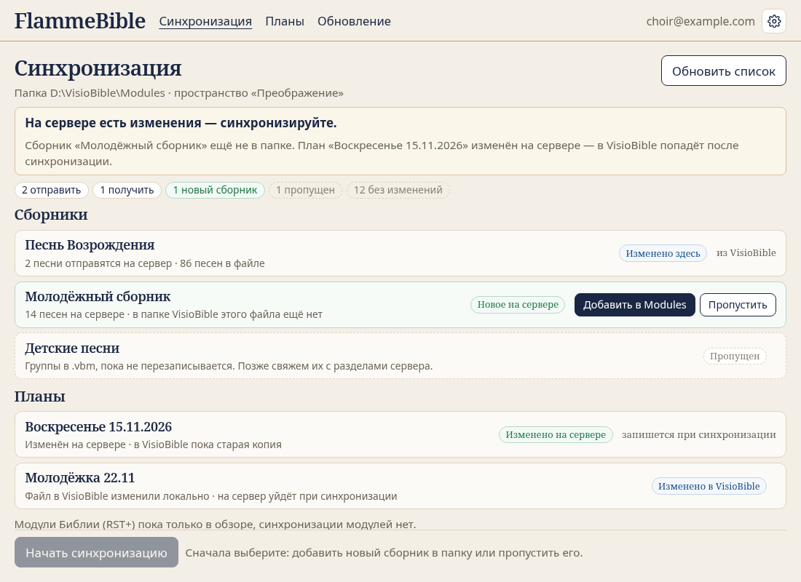
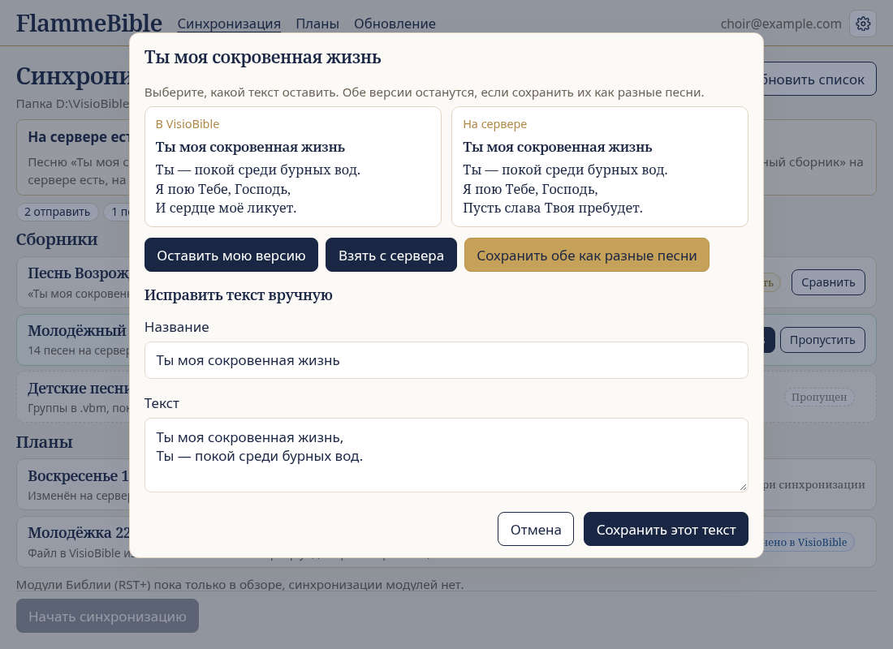
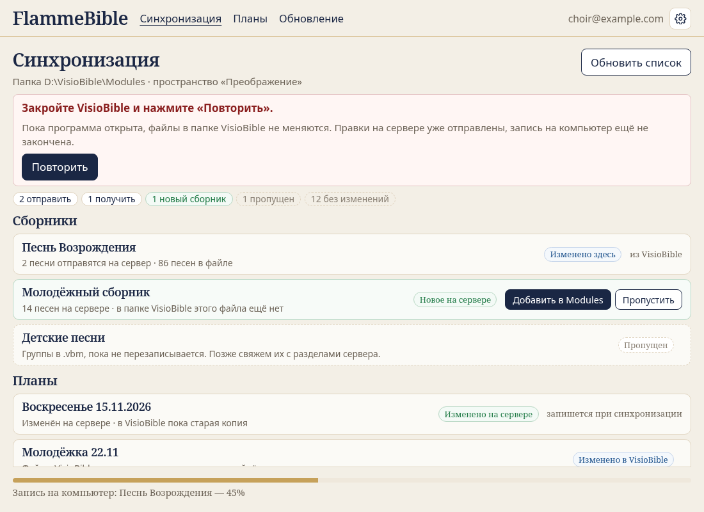
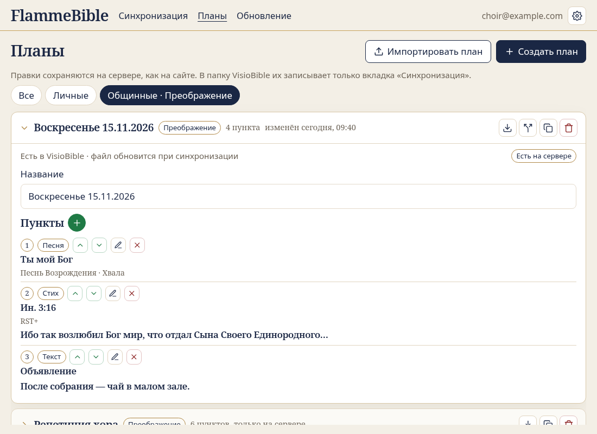
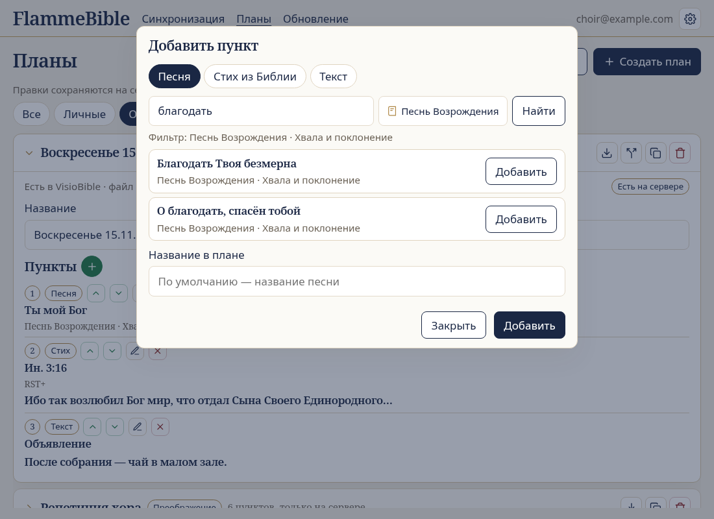
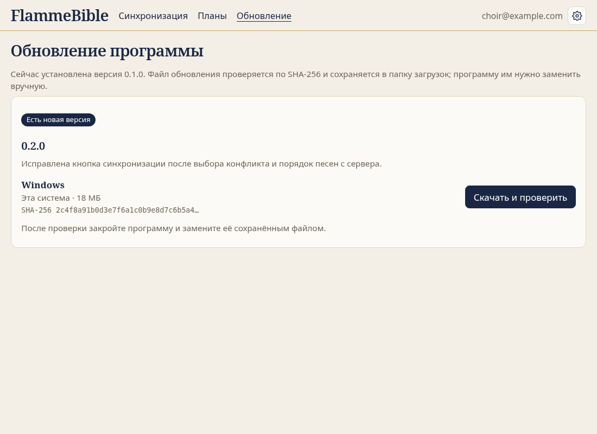
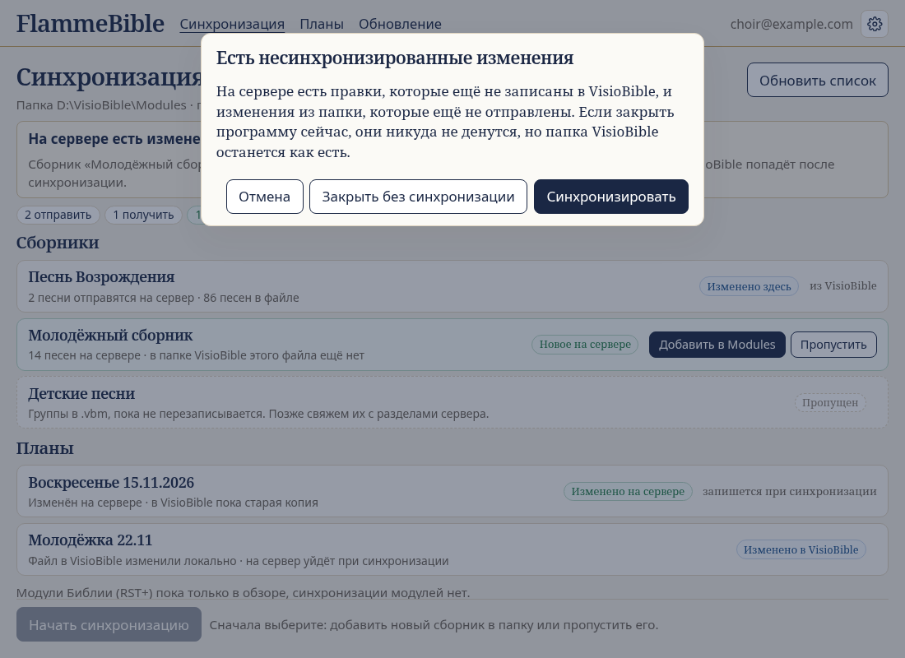

# Макеты настольного клиента

Окна 1100×800. Сцена открывается якорем в `index.html`: `#l1`, `#s3`, `#s1`, `#s2`, `#s4`, `#p1`, `#p2`, `#u1`, `#c1`. Собрать PNG заново: `sh render.sh` (нужен `google-chrome`). В макетах адрес сервера — `https://example.com`, почта — `choir@example.com`.

## Принцип

Правки в клиенте — создание, изменение, дублирование, удаление и импорт планов, правки сборников — меняют только сервер, как на сайте. В папку VisioBible пишет только вкладка «Синхронизация» после «Начать синхронизацию». Исключение: «Скачать план» сохраняет файл туда, куда указал человек, а не в каталог VisioBible.

Вкладка «Синхронизация» открывается по умолчанию. Настройки спрятаны в шестерёнку справа, рядом с почтой. Выход — только в настройках. Если закрыть окно, пока есть несинхронизированное, программа не завершается сразу и спрашивает подтверждение.

Следствия:

- На вкладке «Планы» нет кнопок «Сохранить на этом компьютере» и «Забрать на компьютер».
- Расхождение с папкой появляется, только если человек правил файлы в самой VisioBible или если прошлая синхронизация уже записала туда копию.
- Если на сервере есть план или сборник, которого ещё нет в папке, строка предлагает «Добавить в Modules» или «Пропустить». Без этого выбора «Начать синхронизацию» не запускается.
- «Пропустить» для такого сборника или плана запоминается навсегда на этом компьютере. Клиент хранит список id пропущенных в своих настройках, отдельно для каждого сервера и аккаунта, и больше не спрашивает. Пропущенные не попадают в плашку «На сервере есть изменения» и не вызывают предупреждение при закрытии. Сервер об этом не знает. Внизу вкладки «Синхронизация» свёрнутый блок «Пропущенные (N)»: у каждой строки кнопка «Вернуть». После неё сборник или план снова стоит в списке с выбором «Добавить в Modules» / «Пропустить».
- Кодировка UTF-8 или Windows-1251 — это то, как синхронизация записывает планы в VisioBible. Серверная копия от кодировки папки не зависит.

Шапка как на сайте: слово FlammeBible, вкладки «Синхронизация», «Планы», «Обновление», справа почта и шестерёнка. Отдельной вкладки поиска нет. Поиск песен живёт в модалке «Добавить пункт».

## Вход

Карточка как `AuthSheet` на сайте: золотая кромка, название, подпись «Песни и служение общины», переключатель «Вход / Регистрация». Сверх сайта — поле «Адрес сервера». Кнопка «Войти» вызывает `login` или `register` и перед этим `save_settings` с адресом.

Состояния: пустая форма до входа; ошибка сервера остаётся на этой карточке. После входа открывается «Синхронизация».

## Настройки

Модальное окно с шестерёнки, поверх текущей вкладки. Поля: путь к папке VisioBible, файлу `VisioBible.ini` или каталогу `Modules` (кнопка «Выбрать» открывает диалог папки или файла), адрес сервера, кодировка записи планов, пространство синхронизации. Под путём — что нашлось в папке. Внизу почта вошедшего, кнопки «Выйти», «Отмена», «Сохранить».

Команды: `open_visio`, `save_settings`, `set_plan_encoding`, `list_dimensions`, `select_dimension`, `logout`. «Отмена» закрывает окно и не пишет настройки. Кодировка в подсказке относится только к записи в папку при синхронизации.

## Синхронизация

После входа и выбора папки список строится через `preview_sync`. В шапке — папка и пространство, кнопка «Обновить список».

Если на сервере есть то, чего ещё нет в VisioBible, или в папке есть неотправленное, сверху плашка «На сервере есть изменения — синхронизируйте» и короткий список, что именно: сборники, планы, конфликты. Уже пропущенные на этом компьютере в плашку не входят.

Ниже счётчики: отправить, получить, новые, конфликты, пропущенные, без изменений. Списки такие:

- Сборники — строка на сборник, не плоский список песен. Название, короткое пояснение и статус: «Изменено здесь», «Изменено на сервере», «Новое на сервере», «Нужно выбрать», «Без изменений», «Пропущен».
- Сборник или план, который есть на сервере и отсутствует на этом компьютере: кнопки «Добавить в Modules» и «Пропустить». Пока человек не выбрал, «Начать синхронизацию» выключена, под ней подсказка.
- «Пропустить» записывает id в настройки клиента для этой пары сервер + аккаунт. Строка уходит из основного списка и из плашки. Внизу вкладки свёрнутый блок «Пропущенные (N)». «Вернуть» стирает id из этого списка на этом ПК: строка снова появляется с тем же выбором «Добавить в Modules» / «Пропустить». На сервер запрос не уходит.
- Сборник с группами в `.vbm` по-прежнему со статусом «Пропущен» и пояснением, что файл пока не перезаписывается. Это не тот список, который человек запомнил кнопкой «Пропустить»: группы позже свяжем с разделами сервера, и клиент сам не прячет их в «Пропущенные (N)».
- Планы — те же статусы. «Изменено на сервере» значит, что правку сделали на сайте или во вкладке «Планы»; в VisioBible она попадёт только после синхронизации. «Изменено в VisioBible» — файл в папке расходится с сервером и уйдёт на сервер при синхронизации.
- Модули Библии — пока только обзор, без синхронизации. В макете это одна строка под списками.

Нижняя панель: «Начать синхронизацию» и прогресс (`sync-progress` / `start_sync`). На макете кнопка выключена, потому что новый сборник ещё без выбора.

## Конфликт

Та же вкладка «Синхронизация», если песню изменили и в папке, и на сервере. Плашка перечисляет конфликт. У строки сборника статус «Нужно выбрать» и кнопка «Сравнить». Счётчик конфликтов становится ненулевым.

Модалка по смыслу как сейчас `ConflictModal`: слева текст из VisioBible, справа с сервера. Действия: «Оставить мою версию», «Взять с сервера», «Сохранить обе как разные песни», правка названия и текста вручную («Сохранить этот текст»). «Отмена» закрывает модалку и не снимает конфликт.

Пока выбор не сделан, «Начать синхронизацию» выключена. После выбора кнопка включается. В вёрстке нельзя снова считать оставшиеся конфликты так, чтобы кнопка оставалась выключенной после решения.

## VisioBible запущена

Синхронизация дошла до записи в папку, а VisioBible ещё открыта. Красная плашка: «Закройте VisioBible и нажмите „Повторить“». Файлы в папке не меняются. Правки, которые уже ушли на сервер, на сервере остаются; запись на компьютер не закончена. Кнопка «Начать синхронизацию» на это время скрыта, виден прогресс остановленной записи и «Повторить».

## Планы

Как на сайте. Подсказка под заголовком: правки сохраняются на сервере, в папку их записывает только «Синхронизация». Фильтр «Все / Личные / Общинные», у общинных — имя выбранной общины. Кнопки шапки: «Импортировать план», «Создать план». Оба пишут на сервер (`POST /api/plans`, `POST /api/plans/import`).

Карточка-гармошка. В шапке иконки: «Скачать план», «Дополнить пунктами из другого плана», «Дублировать план», «Удалить план». Правка названия и пунктов сразу уходит на сервер (`PUT /api/plans/{id}` или существующий `push_plan`). «Скачать» открывает выбор файла на диске (`export_plan` / `render_plan_export` и `write_plan_export`) и папку VisioBible не трогает. Удаление подтверждается и снимает план с сервера (`delete_plan`); файл в папке исчезнет только при следующей синхронизации.

В карточке видно, есть ли план уже в VisioBible («файл обновится при синхронизации») или он «только на сервере» и появится в папке после синхронизации. Пункты: песня, стих, текст, порядок, правка, удаление пункта.

## Добавить пункт

Модалка поверх вкладки «Планы», та же, что на сайте. Типы «Песня / Стих из Библии / Текст». Для песни — фильтр сборника и раздела и поиск (`search_songs`). Выбранная песня попадает в план на сервере, не в файл VisioBible. «Закрыть» отменяет несохранённый пункт.

## Обновление

Карточка в стиле страницы загрузки на сайте. Видны установленная версия, проверка и, если сервер отдал новую, номер, заметка и кнопка «Скачать и проверить» для системы этого компьютера. Рядом размер и SHA-256. Команды: `check_update`, `download_update`. Файл сохраняется в папку загрузок. Установка по-прежнему ручная: программу закрывают и заменяют проверенным файлом.

Состояния: версия совпадает с сервером; есть новая версия; ошибка проверки суммы — файл не предлагают ставить.

## Закрытие окна

Крестик окна не завершает программу, если осталось несинхронизированное: серверные правки ещё не записаны в VisioBible, в папке есть неотправленные файлы, конфликт без выбора или нерешённый «Добавить в Modules» / «Пропустить». В Tauri 2 это `CloseRequested` с `prevent_close`.

Диалог «Есть несинхронизированные изменения». Текст говорит, что правки никуда не денутся, но папка останется как есть. Кнопки:

- «Синхронизировать» — переход на вкладку «Синхронизация» и запуск, если выбор уже сделан; иначе остаёмся на списке, чтобы человек выбрал «Добавить в Modules» или «Пропустить».
- «Закрыть без синхронизации» — закрыть окно.
- «Отмена» — остаться в программе.

Запомненные пропуски этого компьютера предупреждение не вызывают: для клиента это уже решённое «не копировать сюда».
